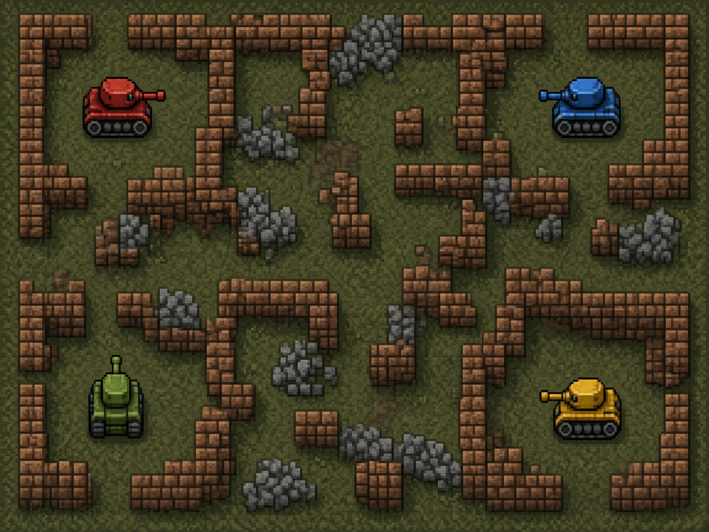

# Tank Turf

Four tanks, one brick field, one keyboard. Tank Turf is a local four-player battle on a destructible maze: shells chew through brick, glance off steel, and the last tank — or the last team — takes the round.

## Launch

The game is plain HTML, JavaScript, and CSS. It stays on your machine and does not download libraries. Python 3 serves it and opens the browser.

| Platform | Launcher |
| --- | --- |
| macOS | Double-click `launch-mac.command` |
| Windows | Double-click `launch-windows.bat` |
| Linux | `./launch-linux.sh` |

From a terminal, in this folder:

```bash
python3 server.py
```

That listens on `127.0.0.1:8809` and opens `index.html`. If 8809 is taken, the server steps to the next free port. The launchers print a short message if Python 3 is missing.

## Controls

Every seat can be a person, a bot, or empty. On the crew screen, a player's **action** key joins, and **secondary** cycles bot and off. `Q` switches free-for-all and 2v2. `[` and `]` change the round count. `Enter` starts the battle. `Tab` opens settings.

| Player | Move | Action (fire) | Secondary (mine) |
| --- | --- | --- | --- |
| P1 Gold | W A S D | F | G |
| P2 Sage | Arrow keys | `/` | `.` |
| P3 Azure | I J K L | `;` | `'` |
| P4 Crimson | Numpad 8 4 5 6 | Numpad 0 | Numpad Enter |

Gamepads in browser slots 0–3 take over P1–P4. The left stick or D-pad moves, **A** fires, **B** drops a mine, and **Start** pauses. While a pad is connected it replaces that seat's keyboard keys, and the HUD shows a pad icon. Unplug it and the keyboard comes back immediately.

`Esc` pauses. `M` mutes. Pause → Settings changes volume, the round count, and every binding. Bindings are stored in `localStorage` under `tankturf-settings`. `Esc` and `M` stay reserved.

## Rules

- The field is a top-down tile maze. **Brick** breaks when a shell hits it. **Steel** never breaks.
- Tanks face and drive in four directions. Each tank has **one shell in the air** at a time.
- A shell **bounces once** off steel, then explodes on the next steel hit.
- **Free-for-all:** every tank is an enemy. **2v2:** Gold and Sage are West, Azure and Crimson are East, and friendly fire is off. Teammate shells and mines pass through.
- Each tank starts a round with **3 lives**. A hit spends a life and the tank respawns at its corner while lives remain. At 0 it is out for the round.
- **Secondary** drops one mine behind the tank. An enemy that touches it loses a life. A shot detonates a mine.
- Brick breaks sometimes leave a pickup: shield, speed, blast (the next shell clears neighboring brick), or an extra life (capped at 5).

Empty seats are bots, so one person can play. A match needs at least two tanks.

## Scoring

- A life taken from an opponent is **1 KO**.
- The last tank standing wins the round in free-for-all. The last team with anyone left in wins the round in 2v2, and both teammates earn that round win.
- If the last tanks go out together, the round is a draw.
- A match is a set number of rounds (1–9, default 3). Highest round wins takes the turf. A tie on rounds goes to KO score. The results screen offers a rematch or a return to the title. The match seed is shown there; the same seed and the same inputs replay the same battle.

## arcade.json

`arcade.json` is the cabinet manifest: display name, id `tankturf`, cover and icon paths, per-platform launch commands, 4 player seats, minimum 1 human, keyboard and gamepad input, version `1.0.0`, and port **8809**.

## Tests

Core rules live in `src/core/` and do not touch the DOM, so Node can run them with no packages installed:

```bash
node --test tests/
python3 tests/smoke_server.py
```

The Node suite covers movement and collision, shells, scoring, elimination, round and match wins, power-ups, mines, the seeded RNG (including a deterministic bot replay), keyboard and gamepad mapping, and `arcade.json`. The Python smoke test launches `server.py` without a browser and checks that `index.html` is served, including when the preferred port is already taken. GitHub Actions runs both.

## License

[MIT](LICENSE)
